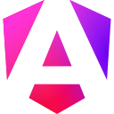

  

  <picture>
    <source media="(prefers-color-scheme: dark)" srcset="assets/cleia-hq-dark-safe.gif" />
    <source media="(prefers-color-scheme: light)" srcset="assets/cleia-hq-light-safe.gif" />
    
  </picture>

<strong>Engenharia de software · Inteligência artificial · Dados · Estratégia</strong>

Transformamos processos complexos em sistemas conectados, com clareza de domínio, automação e engenharia.

## O que construímos

A Epûa conecta tecnologia às operações empresariais. Desenvolvemos plataformas web, ERP, SaaS, integrações, soluções de inteligência artificial e sistemas de informação. Nossa atuação também inclui cloud, FinOps, cibersegurança, prototipagem de hardware e IoT.

| Frente | Aplicação |
| :--- | :--- |
| **Engenharia de software** | APIs, aplicações web, sistemas empresariais e modernização de plataformas. |
| **Inteligência artificial e agentes** | Desenvolvimento de soluções de IA, orquestração de múltiplas LLMs, agentes de engenharia de software e automação integrada aos sistemas do negócio, com avaliação, rastreabilidade e controle de acesso. |
| **Dados e inteligência financeira** | Pipelines, modelagem, indicadores e pesquisa aplicada a cenários e projeções com Quantitative Finance Engine. |
| **Cloud e FinOps** | Arquitetura, automação de infraestrutura, observabilidade e gestão do consumo de tecnologia. |
| **Segurança** | Modelagem de ameaças, proteção de APIs, Spring Security, práticas OWASP e testes de segurança com escopo autorizado. |
| **Hardware e IoT** | Provas de conceito, firmware, sensores e integração entre dispositivos, software e dados. |

## Nosso ecossistema

| Solução | Domínio |
| :--- | :--- |
| **Core** | Gestão financeira, controladoria, fiscal, planejamento e integração dos processos empresariais. |
| **Eixo** | Atendimento, serviços, agenda e relacionamento com clientes. |
| **Marketplace** | Catálogo, estoque, pedidos e operação comercial multicanal. |
| **Agro** | Gestão de safras, produção, custos e operação comercial do agronegócio. |
| **Atlas** | Importação, exportação, logística, documentos e custos de comércio exterior. |
| **Consultoria Advisory TI** | Software sob medida, IA, dados, infraestrutura e projetos de transformação tecnológica. |

## Tecnologias

  
  
  
  
  
  
  
  
  
  
  
  
  
  

| Camada | Ferramentas e ambientes |
| :--- | :--- |
| **Backend e runtimes** | Java, Spring Boot, JVM, GraalVM, Python e Go. |
| **Frontend** | JavaScript, TypeScript, Angular e React. |
| **Dados e eventos** | PostgreSQL, MySQL, Redis e Apache Kafka. |
| **Infraestrutura e entrega** | Docker, Kubernetes, JFrog e pipelines de CI/CD. |
| **Cloud** | AWS, Microsoft Azure e Google Cloud. |

## Como pensamos engenharia

- **Domínio primeiro:** DDD para explicitar regras, vocabulário e limites de responsabilidade.
- **Dependências controladas:** arquitetura hexagonal e contratos de APIs para separar negócio, persistência e integrações.
- **Integrações confiáveis:** eventos, idempotência, rastreabilidade e tratamento explícito de falhas.
- **Qualidade verificável:** testes unitários, de integração, E2E, desempenho e validação de observabilidade.
- **Segurança desde o projeto:** menor privilégio, isolamento por organização, gestão de segredos e análise de dependências.
- **Evolução com evidências:** documentação, ADRs, PoCs, refinamento técnico e critérios de aceite.

Escolhemos a arquitetura conforme o problema, o volume e os requisitos da operação. Sistemas distribuídos e modelos quantitativos exigem decisões explícitas sobre consistência, custo e limites.

## A Cleia dá as boas-vindas

A Cleia é a avatar da Epûa e faz parte da nossa experiência de atendimento. Os agentes de software compõem uma frente própria de engenharia e automação, com responsabilidades e controles definidos em cada projeto.

## Vamos conversar

[E-mail comercial](mailto:contato@epua-dev.com) · [WhatsApp comercial](https://wa.me/5511972713216)

<strong>Fundada por Leticia Ferreira de Paula · CEO e fundadora</strong>

